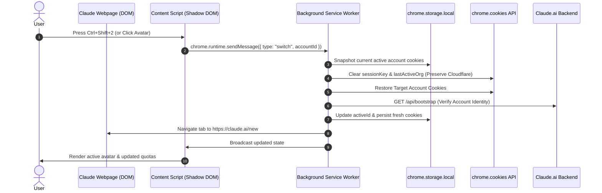

# Claude Switch ⚡

> **The definitive multi-account switcher and rate-limit manager for Claude.ai. Seamlessly switch accounts in one click or keyboard shortcut, track quota resets in real time, and receive desktop notifications the moment your limits expire.**

[](https://github.com/websmartbd/Claude-Switch/releases/tag/v1.2.1)
[](https://developer.chrome.com/docs/extensions/mv3/intro/)
[](https://creativecommons.org/licenses/by-nc/4.0/)
[](https://github.com/websmartbd/Claude-Switch)
[-success.svg?style=for-the-badge)](https://github.com/websmartbd/Claude-Switch)

---

## 📑 Table of Contents

- [Overview](#-overview)
- [Why Claude Switch?](#-why-claude-switch)
- [Key Features](#-key-features)
- [How It Works (Under the Hood)](#-how-it-works-under-the-hood)
  - [1. Cookie Jar & Session Virtualization](#1-cookie-jar--session-virtualization)
  - [2. Cloudflare Clearance Token Preservation](#2-cloudflare-clearance-token-preservation)
  - [3. Intelligent Rate Limit Detection & Expiry Engine](#3-intelligent-rate-limit-detection--expiry-engine)
  - [4. Background Alarms & Push Notifications](#4-background-alarms--push-notifications)
  - [5. Closed Shadow DOM In-Page UI](#5-closed-shadow-dom-in-page-ui)
  - [6. High-Priority Global Shortcut Pipeline](#6-high-priority-global-shortcut-pipeline)
- [Architecture & Data Flow](#-architecture--data-flow)
- [Installation Guide](#-installation-guide)
- [How to Use](#-how-to-use)
- [Keyboard Shortcuts](#-keyboard-shortcuts)
- [Privacy & Security Audit](#-privacy--security-audit)
- [Permissions Justification](#-permissions-justification)
- [Troubleshooting & FAQ](#-troubleshooting--faq)
- [License & Attribution](#-license--attribution)
- [Disclaimer](#-disclaimer)

---

## 🌟 Overview

**Claude Switch** is an open-source, client-side productivity extension built for Chromium-based browsers (**Google Chrome, Brave, Microsoft Edge, Arc, Opera, Vivaldi**).

If you use multiple Claude accounts (personal, work, development, client-specific), logging out, checking emails for magic links, or completing Google Auth every time you hit a rate limit is tedious and disrupts your workflow. **Claude Switch** completely eliminates this friction:

- It holds your authenticated sessions simultaneously in an isolated local store.
- It switches the active Claude session by replacing the relevant Claude cookies and verifying the resulting identity.
- It displays available usage snapshots for supported paid plans and detects some Free limit messages shown in the Claude page.
- When a detected reset time is reached, your operating system can receive a native notification.

---

## 🎯 Why Claude Switch?

| Feature | Standard Browser | Claude Switch |
|---|---|---|
| **Simultaneous Accounts** | ❌ Log out & log in manually | ✅ Multiple accounts stored locally |
| **Switch Duration** | Manual sign-in flow | Depends on cookie restore and Claude verification |
| **Keyboard Switching** | ❌ None | ✅ `Ctrl + Shift + 1` .. `9` anywhere |
| **Rate Limit Awareness** | ❌ Trial and error | ✅ Usage snapshots + detected Free reset countdown |
| **Reset Notifications** | ❌ None | ✅ Scheduled desktop reminder after a detected reset time |
| **Privacy & Storage** | Varies | Local Chrome profile storage; communicates with Claude first-party endpoints |

---

## ✨ Key Features

- 🔄 **One-Click Account Switching:** Request a switch from the in-page control or toolbar popup; the extension verifies the target account before reporting success.
- ⚡ **Global Shortcuts (`Ctrl + Shift + 1..9`):** Switch profiles immediately from anywhere on `claude.ai`, even while typing inside the prompt box.
- ⏱️ **Detected Free Limit Countdown:** Automatically parses Claude's rate limit notices (*"You are out of free messages until 5:20 PM"*) and computes a dynamic percentage bar and remaining time (`100% · in 1h 45m`).
- 🔔 **Instant Desktop Notifications:** Receive a desktop notification when an account reaches its scheduled reset time:
  > *"Your (Nickname) (Plan) claude account limit has been reset"*  
  Clicking a reset notification first requests a switch to the associated saved account; a new chat tab opens only if the switch succeeds.
- 📊 **Pro & Max Quotas:** Displays 5-hour rolling session and 7-day weekly utilization metrics for paid tiers.
- 🎨 **Visual Status Avatars:**
  - 🟢 **Normal / Ready:** Account is ready to chat.
  - 🟡 **Warning:** Usage ≥ 70%.
  - 🔴 **Critical:** Account limit reached (100%), showing exact reset countdown.
- 🪟 **Minimalist In-Page Floating Avatar:** Seamlessly positioned right beside Claude's sidebar footer buttons (`.df-footer-aux`), blending invisibly into Claude's native design system.
- 🛡️ **Zero Telemetry & 100% Local:** No analytics, no remote database, no tracking scripts. All data remains in your browser's `chrome.storage.local`.

---

## 🔬 How It Works (Under the Hood)

Claude Switch achieves seamless switching through a combination of low-level Chrome extension APIs and client-side DOM intelligence.

### 1. Cookie Jar & Session Virtualization
Claude.ai authenticates requests using HTTP-only session cookies (`sessionKey`, `lastActiveOrg`).
- When you add an account, the background service worker takes a snapshot of Claude's active cookies using `chrome.cookies.getAll()`.
- The snapshot is stored in the extension's `chrome.storage.local`. **By default this is NOT encrypted**; anyone or any software with access to the same browser profile may be able to read these session credentials. Since 1.2.0 you can turn on **passphrase protection** (Manage → Turn on protection): each account's cookies are then encrypted with AES-256-GCM (key derived from your passphrase with PBKDF2-SHA256, 600,000 iterations). The unlocked key is kept only in `chrome.storage.session` (browser memory) and is discarded when you click Lock or close the browser. If you forget the passphrase, saved sessions cannot be recovered; you sign in again.
- When switching from Account A to Account B:
  1. The extension snapshots and saves Account A's current session tokens.
  2. It cleans Claude's session cookies.
  3. It injects Account B's stored cookies using `chrome.cookies.set()`.
  4. It queries `/api/bootstrap` to verify identity and update organization UUIDs.
  5. It reloads active Claude tabs directly to `https://claude.ai/new` to prevent 404 conversation errors.

### 2. Cloudflare Clearance Token Preservation
Claude runs behind Cloudflare bot protection (`__cf_bm`, `cf_clearance`, `_cfuvid`). 
If an extension clears all cookies blindly, Cloudflare will trigger a CAPTCHA challenge on every single switch!
**Claude Switch solves this:** The internal `PRESERVED_COOKIES` whitelist leaves Cloudflare clearance tokens untouched during cookie swapping, ensuring you never face unnecessary CAPTCHA puzzles when toggling accounts.

### 3. Intelligent Rate Limit Detection & Expiry Engine
Claude's official `/usage` endpoint may not expose the Free-account message window in the same form as paid-plan usage. Claude Switch attempts to detect supported rate-limit text in the page DOM; this is best-effort and can break when Claude changes its UI:
- A `MutationObserver` continuously scans page banners and alert containers for strings matching:  
  `out of (?:free )?messages until ([0-9]{1,2}:[0-9]{2}(?: AM|PM)?)`
- When detected, the text (e.g. `5:20 PM`) is parsed into an absolute UNIX timestamp (`resetsAt`).
- **Intelligent Tomorrow-Aware Guard:** Claude free limits operate on dynamic rolling windows. If a banner states "tomorrow", the engine reliably calculates next-day timestamps up to 24 hours. Past timestamps without an explicit "tomorrow" indicator are treated as immediately expired, eliminating false future limits and phantom alarms.
- The state is persisted in `cas:freeLimits` so countdowns remain accurate even when switching to other accounts.

### 4. Background Alarms & Push Notifications
- When an account limit is detected, a persistent alarm is scheduled with `chrome.alarms.create("reset:" + accountId, { when: resetsAt })`.
- Even if your browser is minimized or you are browsing other websites, the service worker wakes up at the exact timestamp.
- It verifies the reset, purges the rate-limit flag from storage, and dispatches a native desktop notification via `chrome.notifications.create()`.
- Clicking the notification automatically opens `https://claude.ai/new` on that account.

### 5. Closed Shadow DOM In-Page UI
To guarantee zero CSS contamination:
- The in-page switcher mounts into an isolated **closed** Shadow Root (`mode: "closed"`).
- Claude's complex Tailwind and React stylesheets cannot alter or break the extension's UI, and the extension's CSS cannot bleed into Claude's layout.
- The floating avatar dynamically anchors to Claude's sidebar footer (`.df-footer-aux`), adjusting its placement automatically across viewport resizes and SPA navigations.

### 6. High-Priority Global Shortcut Pipeline
- The keyboard listener attaches to `window` in the **capture phase** (`true`).
- It bypasses default input-focus blocks, meaning `Ctrl + Shift + 1..9` executes even when your cursor is blinking inside Claude's message prompt box.
- It normalizes keycodes across standard number rows, Numpad keys, and shifted character symbols (`!`, `@`, `#`...) across international keyboard layouts.

---

## 🏗️ Architecture & Data Flow



---

## 📥 Installation Guide

### Option 1: Load as Unpacked Extension (Recommended)

1. **Download:**
   - Clone this repository or download the source code as a `.zip` file from the [Releases](https://github.com/) page.
   - Extract the `.zip` archive into a folder (e.g. `Documents/Claude-Switcher`).

2. **Open Extensions Page:**
   - **Google Chrome:** Visit `chrome://extensions`
   - **Brave Browser:** Visit `brave://extensions`
   - **Microsoft Edge:** Visit `edge://extensions`
   - **Arc Browser:** Visit `arc://extensions`

3. **Enable Developer Mode:**
   - Toggle on the **"Developer mode"** switch located in the top-right corner.

4. **Load the Extension:**
   - Click the **"Load unpacked"** button in the top-left toolbar.
   - Select the `Claude-Switcher` folder containing `manifest.json`.
   - The extension will appear instantly with the **Claude Switch** icon!

5. **Pin to Toolbar (Optional):**
   - Click the puzzle icon in your browser toolbar and pin **Claude Switch** for quick access.

---

## 💡 How to Use

### Adding Accounts
1. Sign in to your first Claude account on [claude.ai](https://claude.ai).
2. Click the floating avatar icon at the bottom of the sidebar (or open the toolbar popup).
3. Click **"+ Add another account"**.
4. The extension will safely store your current account, clear session cookies, and open a login tab.
5. Sign in to your second account with Google or email magic link.
6. The extension automatically detects authentication, captures the session, and registers the new profile!
7. Repeat for as many accounts as you need.

### Switching Accounts
- **Method 1:** Press **`Ctrl + Shift + 1`**, **`Ctrl + Shift + 2`** ... **`Ctrl + Shift + 9`** anywhere on Claude.
- **Method 2:** Click the small circular avatar in the sidebar footer to open the quick-switcher menu, then click any account.
- **Method 3:** Click the extension icon in your browser toolbar to switch from the popup.

---

## ⌨️ Keyboard Shortcuts

| Shortcut | Description | Context |
|---|---|---|
| `Ctrl + Shift + 1` | Switch instantly to Account #1 | Anywhere on `claude.ai` |
| `Ctrl + Shift + 2` | Switch instantly to Account #2 | Anywhere on `claude.ai` |
| `Ctrl + Shift + 3..9` | Switch instantly to Accounts #3 through #9 | Anywhere on `claude.ai` |
| `Click on Avatar` | Toggle in-page account switcher dropdown | Sidebar footer |
| `Escape` | Dismiss / close the open switcher dropdown | When dropdown is open |

> **Note:** Shortcuts are designed with non-conflicting modifier keys (`Ctrl + Shift`), ensuring they never trigger browser tab switching (`Alt + 1..9`).

---

## 🔒 Privacy & Security Audit

Authentication tokens grant access to your private AI conversations. Claude Switch is architected around a strict zero-trust local model:

- ❌ **No Analytics / Telemetry:** No Google Analytics, no Mixpanel, no Sentry, no remote beacons.
- ❌ **No External Servers:** The extension does not own, manage, or contact any backend server.
- 🌐 **Direct First-Party Connections Only:** Network requests (`fetch`) communicate solely with `https://claude.ai/*`.
- 🗄️ **Local Profile Storage & LevelDB Compaction:** Authentication cookies, labels, and rate-limit metadata are stored in `chrome.storage.local`. Optional AES-256-GCM passphrase encryption can be enabled in Manage. Note that on Chromium, previous unencrypted storage logs in LevelDB may persist on disk until Chromium's internal LevelDB compaction cycle completes. Even then, malware running as you while the vault is unlocked can still reach the key in memory; treat the browser profile as sensitive.
- 👁️ **Source Available for Inspection:** The JavaScript extension files are included in this repository. The distributed files are bundled JavaScript; original TypeScript source maps and a complete TypeScript source tree are not included.

---

## 🔑 Permissions Justification

In accordance with Chrome Web Store Developer Policies:

| Permission | Purpose |
|---|---|
| `cookies` | Required to read, snapshot, and restore session authentication tokens strictly for `claude.ai` domains. |
| `storage` | Used to persist account identifiers, labels, colors, and rate-limit reset timestamps locally. |
| `alarms` | Used to schedule background wakeups to check rate-limit expiration and update badge counts. |
| `notifications` | Used to deliver native desktop push notifications when an account limit resets. |
| `webRequest` (optional) | Not granted at install. Requested only if you turn on the "Wrong-account helper" in Manage; it watches 403/404 responses from `claude.ai/api/*` to suggest the right account. Turn the toggle off to revoke it. |
| `host: https://claude.ai/*` | Restricts extension code injection and cookie manipulation exclusively to Claude's official domain. |

---

## ❓ Troubleshooting & FAQ

#### Q: Why didn't the rate-limit countdown appear immediately?
**A:** Claude displays rate limits only after a message is rejected by the server (e.g. *"You are out of free messages until..."*). Once that banner appears, Claude Switch immediately parses the time, generates the countdown bar, and schedules your reset notification.

#### Q: Do I need to re-login every time I restart my computer?
**A:** No. Your session cookies remain safely preserved in `chrome.storage.local`. Unless you manually click "Sign Out" inside Claude, your sessions persist across browser restarts.

#### Q: Why do we use `Ctrl + Shift + Number` instead of `Alt + Number`?
**A:** In Chrome and Brave on Linux and Windows, `Alt + 1..9` and `Ctrl + 1..9` are reserved browser accelerators that switch tabs. `Ctrl + Shift + Number` provides universal compatibility without conflicting with browser navigation.

#### Q: What happens if an account session expires?
**A:** If a session token expires naturally on Claude's servers, the extension marks that account with a red label (`signed out — sign in again`). Clicking it opens the login flow to refresh that account's session.

---

## 📄 License & Attribution

This project is licensed under the **Creative Commons Attribution-NonCommercial 4.0 International License (CC BY-NC 4.0)**.

```
Attribution-NonCommercial 4.0 International (CC BY-NC 4.0)

You are free to:
1. Share — copy and redistribute the material in any medium or format.
2. Adapt — remix, transform, and build upon the material.

Under the following terms:
- Attribution: You MUST give appropriate credit to the original author, provide a link
  to the license, and indicate if changes were made.
- Non-Commercial: You may NOT use this material for commercial purposes, sell this software,
  or charge fees for its distribution.
- Open Derivative Works: Any modified versions must remain non-commercial and carry clear
  attribution back to the original author.
```

Review the full terms in the [LICENSE](LICENSE) file.

---

## ⚠️ Disclaimer

*Claude Switch is an independent open-source tool developed by the community. It is **not** an official product of Anthropic, PBC and is not affiliated with, sponsored by, or endorsed by Anthropic, PBC. "Claude", "Claude.ai", and related marks are trademarks of Anthropic, PBC.*


## 1.2.1 patch release

- **Rate limit detection accuracy:** `parseTimeToday` strictly validates whether Claude specified "tomorrow"; expired limits during the same day are correctly marked as elapsed instead of rolling over to tomorrow.
- **Chat false-positive prevention:** `extractResetTime` strictly checks for explicit limit phrases (`out of messages`, `usage limit`, etc.) before matching time patterns, preventing normal conversations containing times from falsely triggering limit states.
- **Passphrase recovery:** Added emergency session erase option ("Forgot passphrase? Erase sessions") when vault is locked and passphrase is lost.
- **Passphrase confirmation:** Added confirm passphrase input field during vault setup to prevent accidental lockout from typos.
- **Concurrency fix in popup:** Switched free-limit manual clearing in popup from direct storage overwrites to the background message queue (`freeLimit:clear`).
- **Window focus:** Clicking desktop reset notifications now brings the browser window to the foreground (`chrome.windows.update` with `focused: true`).

## 1.2.0 security update

- **Optional passphrase protection** for saved sessions (AES-256-GCM, PBKDF2-SHA256 600k iterations). Locked state blocks switching, never writes cookies in the clear, and keeps ciphertext intact while you rename/reorder accounts. Turn it off any time with your passphrase.
- **`webRequest` is now an optional permission**, requested only when you enable the Wrong-account helper. Fresh installs no longer carry that permission warning.
- **Untrusted-input hardening:** `freeLimit:set` (sent from the claude.ai page) now requires a known account, a sane reset time, and stores only whitelisted, length-capped fields.
- **Compatibility signals:** a clear error when Claude's identity API changes shape, and a popup notice when a paid account's usage endpoint can no longer be read. The in-page pill already falls back to other anchors / a floating position if Claude's sidebar markup changes.
- Note: these changes were made directly in the shipped JavaScript. If you maintain the original TypeScript sources, port them back or the next build will drop them.

## 1.1.1 maintenance update

- Persists cookie `storeId` and `partitionKey` metadata when the browser exposes them, so restoration receives the same context.
- Refreshes account identity, plan, and organization metadata after a successful session verification.
- Reset notification clicks cancel an in-progress add-account flow before switching to the notification account; an existing `/new` tab is reused instead of opening a duplicate.
- Rejects invalid clock values, removes the broad `body.innerText` fallback, and ignores synthetic clicks/keyboard events in the in-page controls.
- Serializes free-limit writes through the background worker to prevent multi-tab cache overwrites, persists notification state, and clears stale reset alarms.
- Caps the popup height at 590px.
- Security note (1.1.1): cookies were stored unencrypted. Encryption is available as an opt-in feature from 1.2.0.

## Testing notes

The release package is checked for JavaScript syntax, valid Manifest V3 JSON, referenced local assets, and ZIP integrity. Live authentication, account switching, Claude usage endpoints, and browser notification behavior require manual testing in a signed-in Chrome profile; they cannot be truthfully certified by static checks alone.
